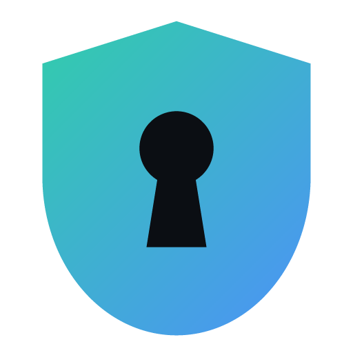

<p align="center">
  
</p>

<h1 align="center">Sentrix</h1>

<p align="center"><strong>A local-only password manager.</strong><br/>
No cloud. No accounts. No servers. Your passwords are encrypted and stay on your computer.</p>

---

## What it does

- **Encrypted vault on your PC.** Logins, secure notes and 2FA (TOTP) codes are stored in one encrypted file.
- **Password generator.** Random passwords or easy-to-type passphrases, with a strength meter.
- **Browser autofill (Chrome, Edge, Brave).** Click the Sentrix icon in a login field to fill it. Sentrix also offers to save new logins and update changed passwords.
- **Move to another computer.** Export an encrypted file, copy it over (USB stick, message to yourself…), and import it. Items are **merged**, so you can sync two PCs back and forth.
- **Import from other managers.** Reads CSV exports from Proton Pass, Chrome, Edge, Firefox, Bitwarden, LastPass and 1Password.
- **Auto-lock.** Locks after inactivity and whenever Windows locks or sleeps. Copied passwords are cleared from the clipboard automatically.

## Download & install (Windows)

1. Go to the [**Releases**](https://github.com/zion07740/sentrix/releases) page and download one of:
   - `Sentrix-Setup-x.y.z.exe`: installer (recommended)
   - `Sentrix-x.y.z-portable.exe`: a single file you can run without installing
2. Run it. Windows will probably show **"Windows protected your PC"**, because the app isn't code-signed (signing certificates cost money). Click **More info → Run anyway**.
   - Want to be sure the file is genuine? Compare its SHA-256 with `SHA256SUMS.txt` on the release page:
     ```powershell
     Get-FileHash .\Sentrix-Setup-x.y.z.exe -Algorithm SHA256
     ```
   - Or [build it yourself](#build-from-source) from this source code.
3. Create your **master password**. Pick something long that you'll remember, such as four or five random words.

> ⚠️ **There is no password reset.** Sentrix has no servers, so nobody can recover your vault if you forget the master password. Write it down and keep it somewhere safe.

## Moving passwords to another computer

On the computer that has your passwords:

1. **Settings → Move passwords to another device → Export encrypted file**
2. Choose an **export password** (you'll type it on the other PC) and save the `.sentrix-export` file.

On the other computer:

1. Install Sentrix and create a vault (its master password can be different).
2. **Settings → Import file…**, pick the `.sentrix-export` file and enter the export password.

Sentrix **merges** instead of overwriting. New items are added, and when an item was edited on both computers, the most recent edit wins. Deleted items stay deleted. To keep two PCs in sync, export and import in both directions now and then.

> The export file is encrypted just like the vault (Argon2id + AES-256-GCM). It's safe to carry on a USB stick. If you send it over the internet, use a strong export password.

## Browser autofill

The extension ships with the app.

1. In Sentrix, open **Settings → Browser autofill → How to install the extension** and click **Show the folder**.
2. In your browser, open `chrome://extensions` (or `edge://extensions`, `brave://extensions`) and turn on **Developer mode**.
3. Click **Load unpacked** and select that `extension` folder.
4. Click the Sentrix icon in the browser toolbar, then **Connect to Sentrix**. The extension shows a 6-digit code. Type that code into the window that pops up in Sentrix.

Now click into any login field and press the small Sentrix shield to fill it.

How it stays safe:

- **Nothing fills automatically.** You always click first, and hidden or off-screen fields are never filled. This blocks the "invisible form" trick some sites use to steal saved passwords.
- **Exact-site matching.** A login is only offered on its own site, based on the real registrable domain. `github.com` logins never show up on `github.com.evil.io`, and `https` logins are never offered on plain `http` pages.
- **Local only.** The extension talks to the app on `127.0.0.1` (your own computer). The app accepts connections only from the Sentrix extension. Every message is encrypted with a key created during pairing, and replayed messages are rejected.
- **Must be unlocked.** If Sentrix is locked, the extension gets nothing.

## Security in one minute

| | |
|---|---|
| Key derivation | **Argon2id**: 64 MiB memory, 3 passes, 4 lanes, random 16-byte salt |
| Encryption | **AES-256-GCM** with a random 256-bit vault key, fresh nonce on every save |
| Integrity | The whole file header is authenticated, so any change to the file is detected |
| Master password change | Re-wraps the vault key. Data is never written unencrypted. |
| Network | The app never connects to the internet. The UI is blocked from making any request, and the only listener is `127.0.0.1` for the extension. |
| App hardening | Sandboxed renderer, context isolation, strict CSP, Electron fuses (no `RunAsNode`, ASAR integrity), and debug flags refused in release builds |
| Brute force | Argon2id makes each guess slow. The app adds increasing delays after failed attempts. |

Full details and the threat model are in [SECURITY.md](SECURITY.md).

**Where is my data?** `%APPDATA%\Sentrix\vault.sentrix`, plus a `vault.sentrix.bak` copy of the previous save. Back up that file whenever you like; it's useless without your master password.

## Build from source

Requirements: Windows 10/11, [Node.js](https://nodejs.org) 22 or newer, Git.

```bash
git clone https://github.com/zion07740/sentrix.git
```

```bash
cd sentrix
```

```bash
npm ci
```

```bash
npm test
```

```bash
npm run dist
```

The installer and portable exe appear in `release/`. For development with hot reload, run `npm run dev`.

### Project layout

```
src/main/            Electron main process (all crypto + file access happen here)
  vault/             crypto.ts, format.ts (file format), store.ts, merge.ts, csv.ts
  bridge/            loopback server for the extension, pairing protocol, site matching
src/preload/         the small, typed API the UI is allowed to call
src/renderer/        React UI (no Node access, sandboxed)
extension/           Chrome/Edge extension (plain JS, no build step)
tests/               unit tests (vitest)
```

## FAQ

**Can I use it on my phone?** Not yet; Sentrix is Windows-only for now.

**My antivirus complains.** New, unsigned apps sometimes get flagged. Check the SHA-256 against the release page, or build from source.

**Does Windows clipboard history keep copied passwords?** It can, if you've turned on clipboard history (Win + V). Sentrix clears the current clipboard after 30 seconds, but entries already saved in Windows clipboard history stay there. If that worries you, turn clipboard history off in Windows Settings → System → Clipboard.

**What happens if I uninstall?** Your vault file is kept in `%APPDATA%\Sentrix`. Delete that folder yourself if you want it gone.

## License

[MIT](LICENSE)
